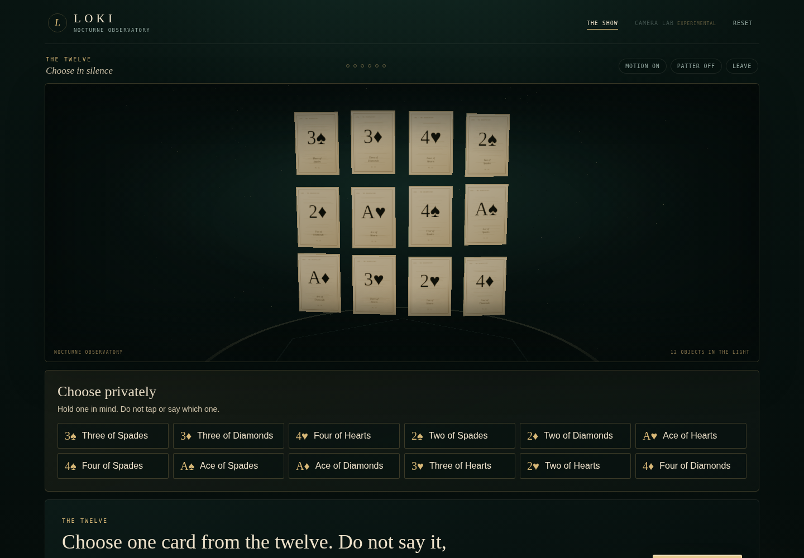

# LOKI v3

**A consent-based performance engine for digital mentalism.** An illusion, not mind reading.

LOKI is a small, offline-first platform: a domain-neutral inference engine, a visible
performance state machine, optional on-device perception, and effects as plugins. The
proof of concept is **The Twelve** — twelve cards, six questions at most, and an honest
miss when the evidence is not there. A second toy effect, **Ember Words**, proves the
plugin contract with no card code in the core.



*Screenshot captured in this GPU-less build container. The app detected that the browser
could not keep a WebGL context and automatically served its flat-stage fallback. On a
WebGL-capable browser the same state renders as the 3D Nocturne Observatory; the flat
stage is the documented degradation path, not a mock-up.*

## What it is

- A **performance**: the spectator chooses silently, answers a few questions, and watches
  a probabilistic guess become a reveal — or a graceful admission that the engine cannot
  tell.
- A **platform**: `packages/engine`, `packages/perception`, and `packages/showrunner`
  compile and test with `effects/card` deleted. Effects own hypotheses, probes, copy, and
  the stage; the core knows none of them.
- A **measured prototype**: 33,000 seeded simulator runs, 95% intervals, calibration, and
  ablations. The shipping card gate passes at a nominal 10% answer-error condition.
  Results confirmed on a held-out seed (99999). 82 unit/property tests. Verified in a
  real browser (BrowserOS neo / Chromium 155): consent, card show, toy effect, and
  camera denial all pass.
- **Local by default**: no account, analytics, database, or upload. The default build
  makes no paid API calls. Camera is optional, local-only, visibly indicated, and never
  feeds the show without a validation gate that this build does not have.

## What it is not

- Not mind reading, telepathy, psychic power, or a supernatural effect.
- Not lie detection, emotion reading, diagnosis, or a medical/safety tool.
- Not a guaranteed-accuracy system. The measured gate is a simulator gate, not a promise.
- Not a 52-card product. Twelve cards is the deliberate, measurable proof of concept.
- Not validated on people. **Human participants: 0.**

Read [the ethics note](docs/ethics.md) and [the evaluation report](docs/eval-report.md)
before using this with anyone.

## Quick start

Requires Node 22+ and npm.

```bash
npm ci
npm run dev
```

Open <http://127.0.0.1:4173>. No API key is needed. The show works with the camera denied.

```bash
npm test              # unit, property, session, simulator, plugin contract
npm run typecheck
npm run lint
npm run build
npm run verify        # all of the above + core-isolation check
npm run eval          # deterministic 33,000-run evaluation
npm run eval:report   # docs/eval-report.md + docs/calibration.svg
npm run eval:heldout  # held-out seed check (simulator seed robustness)
npm run verify:provenance  # catches stale committed artifacts
npm run test:e2e      # Playwright: 9 behavioral tests + screenshot capture
npm run verify:all    # everything above + e2e
```

## The 3-minute demo

The full shot list is in [docs/demo-script.md](docs/demo-script.md). The short version:

1. Read the consent screen aloud: illusion, not mind reading; camera off; stop anytime.
2. Enter **The Twelve**. Ask the spectator to hold one card in mind.
3. Answer the questions. Let the 3D observatory narrow. Do not narrate probabilities.
4. Reveal, or accept the miss. The miss is part of the product, not a failure to hide.
5. Show the evaluation report and the 0-human-participants line.

## Architecture

```text
apps/web (React + Vite + React Three Fiber)
  ├── consent, performance shell, 3D Nocturne Observatory, camera lab
  └── imports only public contracts

packages/effect-api      hypotheses · probes · evidence · channels · claims
packages/engine          log-domain belief · smoothing · outlier mixture · policies
packages/perception      answer/timing/gaze adapters · window aggregation · quality
packages/showrunner      beats · recovery/miss · patter filter · optional LLM rewrite
packages/sim             seeded synthetic spectators · cells · metrics · SVG report

effects/card             The Twelve (3 suits × ranks A–4)
effects/_example         Ember Words (4 words, 3 questions) — plugin proof
```

The core never imports a concrete effect. `npm run verify:isolation` temporarily removes
`effects/card`, typechecks the core, runs the core tests plus the toy effect, and restores
the folder. A lint rule rejects concrete-effect imports from `packages/**`.

### Belief model

- Every answer is a **soft likelihood**, smoothed by `epsilon` and mixed with a uniform
  outlier component. There is no hard elimination in the shipped path.
- Updates happen in the log domain; the posterior is normalized and replayable from the
  evidence log.
- A large surprise or two consecutive surprises enters a **recovery** beat. Recovery spends
  one extra probe; if the gate still is not met, the show ends in a **graceful miss**.
- Commit only when `maxPosterior >= tau`, at least two answers have been given, and no
  contradiction is unresolved. Exhausting the probe budget never auto-reveals.

## Evidence at a glance

From `data/eval-results.json` (seed `20261027`, 1,000 runs per cell, 33 cells):

| Condition | Commits | Wrong | Correct | Wrong / all runs |
|---|---|---|---|---|
| Card, 10% (shipping) | 496 / 1000 | 6 | 490 | 0.6% |
| Ember Words, 10% (toy only) | 739 / 1000 | 20 | 719 | 2.0% |

The card shipping gate passes both 95% upper-bound tests (<3% wrong over all runs,
<10% over commits). Brier is 0.196; ECE is 0.038.
These are synthetic spectators, not people. Human participants: **0**.

The observation-noise audit corrected a model bug: uniform noise is over answer/channel
values, not hypotheses. This changed the earlier 517/509/8 result to
496/490/6 (commits/correct/wrong). All 33 cells and the report were regenerated;
historical artifacts remain under `data/provenance/`.

The held-out seed (99999) now gives 483 commits and 11 wrong, passing both
simulation gates. That checks seed robustness within the same simulator, not human
accuracy. `verify:provenance` reproduces every metric of all 33 cells, not a subset.

**Toy update:** Ember now asks three objective spelling questions with balanced, distinct
partitions. Its unchanged 0.85 threshold permits all four truthful paths to reveal;
all single-answer flips abstain. Two flips can imitate another word and yield a wrong
reveal. The held-out toy run gives 769 commits, 738 correct and 31 wrong out of 1,000.
This does **not** pass the card shipping target and is not a human accuracy claim.
The independent-error simulator does not capture correlated spelling mistakes.
See [the generated evaluation report](docs/eval-report.md) for intervals and stress cells.

## Effects

### The Twelve (proof of concept)

12 cards: hearts, diamonds, spades × Ace–Four. 20 designed binary probes; the greedy policy
uses at most 6 in the shipping config, with at most one recovery probe. `tau = 0.96`,
`epsilon = 0.10`, outlier mixture `0.06`, temperature `1.0`. Gaze and force are off. The
stage shuffles layout per session and logs the seed; the spectator is never asked to click
a card.

### Ember Words (plugin proof)

Four English words, three binary spelling questions, `tau = 0.85`, max 3 probes. It runs through the same
session, belief, recovery, simulator, and UI as the card effect. It is deliberately small
and is not a shipping accuracy claim.

## Camera lab

The participant can opt in on the consent screen. The lab is separate from the show and
never feeds the belief engine.

- A visible **CAMERA ON · LOCAL ONLY** indicator is shown while the stream is open.
- Frames are drawn to a local canvas for diagnostics; nothing is recorded or uploaded.
- **Stop camera** and leaving the lab both stop every track and clear the stream.
  Unmounting during camera acquisition also releases the stream (race condition fixed).
- MediaPipe Face Landmarker runs locally (CPU). Iris landmarks are **not** a gaze ground
  truth; the lab labels its signal “raw, uncalibrated” and keeps the show gate **CLOSED**.
- The lab prefers local assets from `apps/web/public/mediapipe/`, then falls back to a
  public CDN. Run `npm run fetch:gaze-assets` to make the lab work offline.

Why gaze is not in the show: browser gaze error is setup-dependent, with 4.17° reported in
the 2016 WebGazer work and 10.3–13.6° in a 2026 head-still study. Adjacent cards are too
small for that error. See [docs/research.md](docs/research.md).

## Optional LLM patter

Off by default. When enabled in the show, the app calls a **local proxy** at
`/api/patter`; the proxy is the only component that can reach a model. If the key is
missing, the proxy is offline, the request times out, or the output trips the claim filter,
the app keeps the bundled line and shows “offline fallback”.

```bash
cp .env.example .env
# put a key in .env only if you intend to spend money
npm run llm:proxy
npm run dev
```

The default build makes zero paid calls. The model route verified for this build is
`meta-models/muse-spark-open` at `https://inference.baseten.co/v1`; the dated `-1026` ID in
the brief was not found. The proxy sends only a short text template and tone, never audio,
images, camera frames, or identity data.

## CI

A GitHub Actions workflow is prepared at `.github/workflows/ci.yml` (verify + e2e jobs).
Not yet enabled on the remote.

## Repository map

```text
apps/web/               React shell, 3D stage, camera lab
packages/effect-api/    narrow plugin contract, validation, claims
packages/engine/        belief, policies, calibration, replay
packages/perception/    answers, timing, gaze quality/aggregation
packages/showrunner/    session beats, recovery/miss, patter safety
packages/sim/           seeded simulator, metrics, SVG calibration
effects/card/           The Twelve
effects/_example/       Ember Words
data/eval-results.json  machine-readable evaluation
docs/                   research, ethics, design, lessons, eval, demo, screenshots
scripts/                eval, report, isolation, LLM proxy, asset fetch
tests/e2e/              Playwright flows and screenshots
```

## Design and honesty rules

- Say **illusion** and **mentalism**. Never “reads minds,” “lie detection,” “emotion
  reading,” “diagnosis,” “100%,” “guaranteed,” or “world-first.”
- The spectator may lie, decline, or stop. The engine answers with a miss, not a bluff.
- The camera is optional. The no-camera path is primary. No frames are stored or uploaded.
- Do not tune the demo after seeing the eval. The shipping config is fixed in
  `effects/card/src/index.ts` and documented in the report.
- Every number in the README is generated from seeded simulator data. The report is
  derived from the JSON; do not hand-edit it.

## Status and unresolved items

- Deadline: **2026-11-05 02:00 UTC**. Internal target: 2026-11-03 18:00 UTC.
- 0 human participants; the pilot protocol exists but was not run.
- Camera/gaze and force remain off; no human validation.
- Public repo/demo format requirements are `[UNRESOLVED]`; prepared public-ready.
- Real browser test done (BrowserOS neo / Chromium 155): consent, card show, toy effect,
  camera denial all verified. Physical-device matrix (Safari, low-end GPU, phone camera)
  not tested.
- LLM route is optional and not exercised without a key in this environment.
- Long sessions, groups, 52-card decks, voice, and other effects are roadmap.

## License

MIT. See [LICENSE](LICENSE). MediaPipe assets fetched by the optional script retain their
own licenses.
### Local browser-testing tools

BrowserOS/MCP access is an optional developer setup, not a LOKI dependency. Keep its
configuration and clients outside this repository. Removing accidentally committed
copies does not revoke or reconfigure the user's browser access. The portable browser
test suite uses Playwright (`npm run test:e2e`); neither the app nor CI requires MCP.
Earlier manual browser-test entries remain historical reports, not fresh verification.
