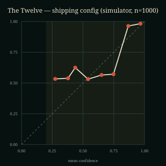

# LOKI v3 — evaluation report

**Status:** simulator-only evaluation. **Human participants: 0.**
This report measures a synthetic answer model, not people. It is evidence about the
implementation's behavior under controlled noise, not proof of real-world accuracy.

**Generated:** 2026-11-04T01:51:42.601Z · **Runs per cell:** 1000 ·
**Seed base:** 20261027 · **Cells:** 33 ·
**Total runs:** 33000

> LOKI is a performance of mentalism — an illusion, not mind reading. The engine uses
> consent-based answers and soft probabilistic inference. It does not detect lies,
> emotions, identity, or any diagnosis.

## 1. Shipping configuration

| Setting | Value |
|---|---|
| Effect | The Twelve (12 cards: 3 suits × ranks A–4) |
| Policy | Greedy expected-information probe selection |
| Max probes | 6 |
| Commit threshold (τ) | 0.96 |
| Answer-error smoothing (ε) | 0.10 |
| Outlier mixture | 0.06 |
| Temperature | 1.0 |
| Gaze | Off (lab only) |
| Force | Off (logged prior, default off) |
| Commit rule | max posterior ≥ τ, at least 2 answers, no unresolved contradiction |

The shipping run uses 1,000 seeded synthetic spectators, each answering with a 10%
per-question error probability. Runs are paired by seed across policies. Intervals are
95% Wilson intervals for proportions; Brier and mean-probe intervals use a normal approximation to the sample mean.

**Shipping result (card / greedy / 10% answer error):**

| Metric | Value |
|---|---|
| Commits | 763 / 1000 (76.3%) [73.6%, 78.8%] |
| Graceful misses | 237 / 1000 (23.7%) |
| Correct reveals | 751 |
| Wrong reveals | 12 |
| Committed accuracy | 98.4% [97.3%, 99.1%] |
| Wrong-confident reveals, all runs | 1.2% [0.7%, 2.1%] |
| Wrong-confident reveals, committed runs | 1.6% [0.9%, 2.7%] |
| Brier score (multiclass) | 0.098 [0.078, 0.118] |
| Expected calibration error (10 bins) | 0.029 |
| Mean probes answered | 5.14 [5.06, 5.23] |
| Mean recoveries | 0.34 |

### Gate decision

The pre-registered gate was **< 3% wrong-confident reveals over all runs** and
**< 10% over committed reveals**, using the upper end of the 95% interval.

- All runs: 1.2% [0.7%, 2.1%] — **PASS**
- Committed runs: 1.6% [0.9%, 2.7%] — **PASS**

**Gate result: PASS at the nominal 10% answer-error condition.**
This is a simulation gate. It does not validate the show with people, and it does not
justify a guaranteed-accuracy claim.

## 2. Card effect by policy

At 15% answer error (a stress condition), compare the policies directly in the table below; the fixed probe order often
exhausts its budget without reaching τ.

| Policy | Commits | Wrong | Committed accuracy | Wrong, all runs | Brier | ECE | Mean probes |
|---|---|---|---|---|---|---|---|
| greedy | 620 / 1000 (62.0%) | 27 | 95.6% [93.7%, 97.0%] | 2.7% [1.9%, 3.9%] | 0.207 [0.178, 0.236] | 0.030 | 5.57 [5.48, 5.66] |
| median | 620 / 1000 (62.0%) | 27 | 95.6% [93.7%, 97.0%] | 2.7% [1.9%, 3.9%] | 0.207 [0.179, 0.236] | 0.028 | 5.57 [5.48, 5.66] |
| fixed | 461 / 1000 (46.1%) | 25 | 94.6% [92.1%, 96.3%] | 2.5% [1.7%, 3.7%] | 0.292 [0.261, 0.323] | 0.036 | 6.99 [6.99, 7.00] |

## 3. Card effect by answer error (greedy)

| Answer error | Commits | Wrong | Committed accuracy | Wrong, all runs | Brier | ECE | Mean probes |
|---|---|---|---|---|---|---|---|
| 0% | 1000 / 1000 (100.0%) | 0 | 100.0% [99.6%, 100.0%] | 0.0% [0.0%, 0.4%] | 0.001 [0.001, 0.001] | 0.028 | 4.17 [4.14, 4.19] |
| 5% | 875 / 1000 (87.5%) | 5 | 99.4% [98.7%, 99.8%] | 0.5% [0.2%, 1.2%] | 0.029 [0.018, 0.039] | 0.032 | 4.72 [4.65, 4.79] |
| 15% | 620 / 1000 (62.0%) | 27 | 95.6% [93.7%, 97.0%] | 2.7% [1.9%, 3.9%] | 0.207 [0.178, 0.236] | 0.030 | 5.57 [5.48, 5.66] |
| 30% | 387 / 1000 (38.7%) | 99 | 74.4% [69.8%, 78.5%] | 9.9% [8.2%, 11.9%] | 0.712 [0.667, 0.757] | 0.235 | 6.15 [6.07, 6.23] |

The show degrades into abstention rather than bluffing as noise rises. At 30% error the
wrong-confident rate crosses the < 3% gate; those runs are outside the shipping envelope
and are reported rather than hidden.

## 4. Ablations

All ablation cells use the card effect, greedy policy, and 15% answer error (a stress
condition), 1,000 runs each.

| Condition | Commits | Wrong | Committed accuracy | Wrong, all runs | Brier | ECE | Mean probes | Decision |
|---|---|---|---|---|---|---|---|---|
| Soft likelihoods + outlier mixture | 620 / 1000 (62.0%) | 27 | 95.6% [93.7%, 97.0%] | 2.7% [1.9%, 3.9%] | 0.207 [0.178, 0.236] | 0.030 | 5.57 [5.48, 5.66] |  Shipping math. Kept as the reference. |
| Hard elimination | 1000 / 1000 (100.0%) | 301 | 69.9% [67.0%, 72.7%] | 30.1% [27.3%, 33.0%] | 0.602 [0.545, 0.659] | 0.301 | 2.00 [2.00, 2.00] |  Dropped. Confidently wrong on half of all runs. |
| No outlier mixture | 694 / 1000 (69.4%) | 34 | 95.1% [93.2%, 96.5%] | 3.4% [2.4%, 4.7%] | 0.209 [0.179, 0.239] | 0.039 | 5.57 [5.48, 5.66] |  Dropped. More wrong reveals and worse calibration. |
| Gaze on (simulated) | 507 / 1000 (50.7%) | 9 | 98.2% [96.7%, 99.1%] | 0.9% [0.5%, 1.7%] | 0.203 [0.176, 0.230] | 0.030 | 3.57 [3.54, 3.60] |  Lab only. Mechanical upper bound, not human evidence. |
| Force on (prior shift) | 634 / 1000 (63.4%) | 25 | 96.1% [94.2%, 97.3%] | 2.5% [1.7%, 3.7%] | 0.206 [0.177, 0.235] | 0.022 | 5.61 [5.52, 5.69] |  Default off. Modest simulated effect, no human evidence. |
| Temperature 0.95 | 755 / 1000 (75.5%) | 35 | 95.4% [93.6%, 96.6%] | 3.5% [2.5%, 4.8%] | 0.211 [0.179, 0.243] | 0.048 | 5.38 [5.29, 5.46] |  Dropped. Overconfident and more wrong commits. |
| Temperature 1.05 | 433 / 1000 (43.3%) | 9 | 97.9% [96.1%, 98.9%] | 0.9% [0.5%, 1.7%] | 0.203 [0.178, 0.228] | 0.037 | 6.18 [6.12, 6.25] |  Dropped. Fewer commits without a clear accuracy gain. |

Interpretation:

- **Soft likelihoods + outlier mixture are non-negotiable.** Hard elimination commits on
  every run and is wrong on roughly half; it is an ablation, never the shipped path.
- **The outlier mixture earns its place.** Removing it produces more wrong reveals and
  worse calibration at the same stress level.
- **Gaze-on results are mechanical.** The simulator feeds a categorical zone with a chosen
  reliability. It cannot show that a browser webcam achieves that reliability. Gaze stays
  in the lab and off in the show.
- **Force-on results are a prior shift.** The simulator samples the forced target more
  often; it is not evidence that a psychological force works on people. Default off.
- **Temperature 1.0 is the best trade.** Lower temperature is overconfident; higher
  temperature buys safety by abstaining more, without a clear accuracy gain.

## 5. Toy effect (plugin contract)

The toy is **Ember Words**: four words, three binary probes, τ = 0.85, max 3 probes. It
exists to prove that the core and simulator do not depend on the card effect. It is not a
shipping effect and was not tuned for the same accuracy target.

| Policy | Commits | Wrong | Committed accuracy | Wrong, all runs | Brier | ECE | Mean probes |
|---|---|---|---|---|---|---|---|
| greedy | 704 / 1000 (70.4%) | 5 | 99.3% [98.3%, 99.7%] | 0.5% [0.2%, 1.2%] | 0.091 [0.070, 0.112] | 0.005 | 2.30 [2.27, 2.32] |
| median | 704 / 1000 (70.4%) | 5 | 99.3% [98.3%, 99.7%] | 0.5% [0.2%, 1.2%] | 0.091 [0.070, 0.112] | 0.005 | 2.30 [2.27, 2.32] |
| fixed | 889 / 1000 (88.9%) | 67 | 92.5% [90.5%, 94.0%] | 6.7% [5.3%, 8.4%] | 0.163 [0.133, 0.193] | 0.013 | 2.24 [2.21, 2.27] |

Toy shipping cell at 10% error: 803 commits, 1 wrong,
99.9% committed accuracy, Brier
0.040. The three probes now ask objective spelling properties: ends in n,
contains m, and odd letter count. They form distinct balanced partitions whose truth
codewords have pairwise Hamming distance two. All four truthful paths reveal; every
single flipped answer abstains. Two flips can imitate another word and cause a wrong
reveal. Threshold, noise, temperature and probe budget are unchanged.

This is a spelling-puzzle plugin proof, not a shipping mentalism accuracy claim. The
independent per-answer simulator cannot establish human calibration: spelling mistakes
may be correlated. The held-out seed gives 10 wrong out of 1000 runs;
its point error rate is 1.0% before interval uncertainty. Do not describe Ember as passing
the card shipping gates. It runs through the identical session, belief, recovery and
simulation code.

## 6. Calibration



Points track the diagonal in the high-confidence region where the show commits. ECE is
0.029 for the shipping cell. The diagram is generated from the same
seeded run data as the table, not from a separate demo. Bins with no observations are
omitted.

## 7. Failure suite

Automated tests exercise: a liar/misclick answer stream, contradictory answers, recovery
budget exhaustion, camera denied, low light/low reliability, glasses (unvalidated), LLM
timeout, offline fallback, and invalid effect definitions. These are correctness tests,
not accuracy measurements; they do not add human evidence. The camera-lab stop/release
path is implemented but was not exercised against a physical camera in this environment.

The no-camera path is the primary product path. Camera code is gated behind an explicit
lab opt-in, processes locally, shows a visible indicator, and is released on stop or error.
No frames, audio, identity data, or embeddings are uploaded or stored.

## 8. Kept and dropped experiments

| Experiment | Decision | Evidence |
|---|---|---|
| Soft likelihoods + outlier mixture | **Kept** | Shipping gate passes; hard elimination fails badly. |
| Contradiction recovery probe | **Kept** | Recovery logic is tested; no isolated recovery ablation was run. |
| Greedy probe selection | **Kept** | Best commit rate; simplest to explain and test. |
| Median / bisection challenger | **Dropped from shipping** | Compare measured trade-offs above; optimality does not generalise to 2-D card hypotheses. |
| Fixed probe order | **Dropped from shipping** | Usually exhausts the budget without a commit. |
| 30% answer-error operation | **Outside envelope** | Gate fails; reported as a stress result. |
| Gaze in the show | **Dropped; lab only** | No human validation; browser gaze error is too large for item-level resolution. |
| Force on by default | **Dropped; default off** | Simulation prior shift is not human evidence; logged when enabled in tests. |
| Temperature ≠ 1.0 | **Dropped** | Worse calibration or unnecessary abstention. |
| 52-card deck | **Roadmap** | Probe length and gaze resolution; 12 cards is the measurable proof. |

## 9. Limitations and unresolved items

- **0 human participants.** No claim about real spectators, real answer-error rates, or
  real-world show accuracy is supported. A pilot protocol is documented; it was not run.
- **Synthetic noise is simplistic.** Answers are independent with a fixed per-question
  error rate. People are correlated, strategic, and affected by wording and pacing.
- **Gaze is unvalidated.** MediaPipe iris landmarks are not a gaze ground truth. The
  camera lab displays quality and never feeds the show without a passed validation gate.
- **Force is unvalidated.** The 3♦ force is implemented as a logged prior and remains off.
- **Optional LLM patter is unvalidated in this environment.** The proxy is off by default,
  requires a key, and falls back to bundled lines on timeout, refusal, or offline.
- **Public repo/demo format:** [UNRESOLVED] The event page does not state whether a public
  URL or a specific video format is required. The repo is prepared public-ready.
- **Physical-device coverage:** browser screenshots are captured at desktop and mobile
  widths; no physical phone, Safari, or low-end GPU was available for this build.
- **Long sessions and group dynamics:** out of scope; the evaluation is one spectator and
  one short effect.
- **Model route:** the verified Baseten route is `meta-models/muse-spark-open`; the dated
  ID in the brief was not found. No paid call is made by the default build.

## 10. Reproduction

```bash
npm ci
npm run eval          # writes data/eval-results.json (deterministic for the fixed seed)
npm run eval:report   # writes docs/eval-report.md and docs/calibration.svg
npm test              # unit, property, session, simulator, and plugin-contract tests
npm run verify        # lint, typecheck, tests, build, and core-isolation check
```

The generated JSON is the machine-readable source of truth. This Markdown report is
derived from it; do not hand-edit numbers.
