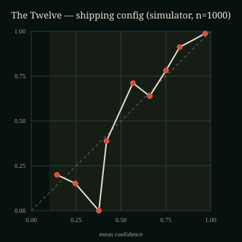

# LOKI v3 — evaluation report

**Status:** simulator-only evaluation. **Human participants: 0.**
This report measures a synthetic answer model, not people. It is evidence about the
implementation's behavior under controlled noise, not proof of real-world accuracy.

**Generated:** 2026-10-29T21:12:32.472Z · **Runs per cell:** 1000 ·
**Seed base:** 20261027 · **Cells:** 33 ·
**Total runs:** 33000

> LOKI is a performance of mentalism — an illusion, not mind reading. The engine uses
> consent-based answers and soft probabilistic inference. It does not detect lies,
> emotions, identity, or any diagnosis.

## 1. Shipping configuration

| Setting | Value |
|---|---|
| Effect | The Twelve (12 cards: 3 suits × ranks A–4) |
| Policy | Greedy expected-information probe selection |
| Max probes | 6 |
| Commit threshold (τ) | 0.96 |
| Answer-error smoothing (ε) | 0.10 |
| Outlier mixture | 0.06 |
| Temperature | 1.0 |
| Gaze | Off (lab only) |
| Force | Off (logged prior, default off) |
| Commit rule | max posterior ≥ τ, at least 2 answers, no unresolved contradiction |

The shipping run uses 1,000 seeded synthetic spectators, each answering with a 10%
per-question error probability. Runs are paired by seed across policies. Intervals are
95% Wilson intervals for proportions; Brier and mean-probe intervals use a normal approximation to the sample mean.

**Shipping result (card / greedy / 10% answer error):**

| Metric | Value |
|---|---|
| Commits | 496 / 1000 (49.6%) [46.5%, 52.7%] |
| Graceful misses | 504 / 1000 (50.4%) |
| Correct reveals | 490 |
| Wrong reveals | 6 |
| Committed accuracy | 98.8% [97.4%, 99.4%] |
| Wrong-confident reveals, all runs | 0.6% [0.3%, 1.3%] |
| Wrong-confident reveals, committed runs | 1.2% [0.6%, 2.6%] |
| Brier score (multiclass) | 0.196 [0.170, 0.222] |
| Expected calibration error (10 bins) | 0.038 |
| Mean probes answered | 6.76 [6.74, 6.79] |
| Mean recoveries | 0.76 |

### Gate decision

The pre-registered gate was **< 3% wrong-confident reveals over all runs** and
**< 10% over committed reveals**, using the upper end of the 95% interval.

- All runs: 0.6% [0.3%, 1.3%] — **PASS**
- Committed runs: 1.2% [0.6%, 2.6%] — **PASS**

**Gate result: PASS at the nominal 10% answer-error condition.**
This is a simulation gate. It does not validate the show with people, and it does not
justify a guaranteed-accuracy claim.

## 2. Card effect by policy

At 15% answer error (a stress condition), compare the policies directly in the table below; the fixed probe order often
exhausts its budget without reaching τ.

| Policy | Commits | Wrong | Committed accuracy | Wrong, all runs | Brier | ECE | Mean probes |
|---|---|---|---|---|---|---|---|
| greedy | 338 / 1000 (33.8%) | 14 | 95.9% [93.2%, 97.5%] | 1.4% [0.8%, 2.3%] | 0.372 [0.338, 0.406] | 0.038 | 6.83 [6.80, 6.85] |
| median | 335 / 1000 (33.5%) | 11 | 96.7% [94.2%, 98.2%] | 1.1% [0.6%, 2.0%] | 0.369 [0.335, 0.403] | 0.035 | 6.83 [6.81, 6.85] |
| fixed | 0 / 1000 (0.0%) | 0 | — | 0.0% [0.0%, 0.4%] | 0.498 [0.465, 0.531] | 0.052 | 7.00 [7.00, 7.00] |

## 3. Card effect by answer error (greedy)

| Answer error | Commits | Wrong | Committed accuracy | Wrong, all runs | Brier | ECE | Mean probes |
|---|---|---|---|---|---|---|---|
| 0% | 923 / 1000 (92.3%) | 0 | 100.0% [99.6%, 100.0%] | 0.0% [0.0%, 0.4%] | 0.001 [0.001, 0.002] | 0.030 | 6.57 [6.54, 6.60] |
| 5% | 666 / 1000 (66.6%) | 3 | 99.5% [98.7%, 99.8%] | 0.3% [0.1%, 0.9%] | 0.075 [0.060, 0.091] | 0.061 | 6.68 [6.66, 6.71] |
| 15% | 338 / 1000 (33.8%) | 14 | 95.9% [93.2%, 97.5%] | 1.4% [0.8%, 2.3%] | 0.372 [0.338, 0.406] | 0.038 | 6.83 [6.80, 6.85] |
| 30% | 148 / 1000 (14.8%) | 46 | 68.9% [61.1%, 75.8%] | 4.6% [3.5%, 6.1%] | 0.920 [0.879, 0.962] | 0.320 | 6.91 [6.90, 6.93] |

The show degrades into abstention rather than bluffing as noise rises. At 30% error the
wrong-confident rate crosses the < 3% gate; those runs are outside the shipping envelope
and are reported rather than hidden.

## 4. Ablations

All ablation cells use the card effect, greedy policy, and 15% answer error (a stress
condition), 1,000 runs each.

| Condition | Commits | Wrong | Committed accuracy | Wrong, all runs | Brier | ECE | Mean probes | Decision |
|---|---|---|---|---|---|---|---|---|
| Soft likelihoods + outlier mixture | 338 / 1000 (33.8%) | 14 | 95.9% [93.2%, 97.5%] | 1.4% [0.8%, 2.3%] | 0.372 [0.338, 0.406] | 0.038 | 6.83 [6.80, 6.85] |  Shipping math. Kept as the reference. |
| Hard elimination | 1000 / 1000 (100.0%) | 479 | 52.1% [49.0%, 55.2%] | 47.9% [44.8%, 51.0%] | 0.958 [0.896, 1.020] | 0.479 | 3.60 [3.57, 3.63] |  Dropped. Confidently wrong on half of all runs. |
| No outlier mixture | 413 / 1000 (41.3%) | 22 | 94.7% [92.1%, 96.5%] | 2.2% [1.5%, 3.3%] | 0.377 [0.340, 0.413] | 0.075 | 6.58 [6.55, 6.62] |  Dropped. More wrong reveals and worse calibration. |
| Gaze on (simulated) | 513 / 1000 (51.3%) | 10 | 98.1% [96.4%, 98.9%] | 1.0% [0.5%, 1.8%] | 0.217 [0.190, 0.244] | 0.035 | 6.08 [6.00, 6.16] |  Lab only. Mechanical upper bound, not human evidence. |
| Force on (prior shift) | 363 / 1000 (36.3%) | 23 | 93.7% [90.7%, 95.7%] | 2.3% [1.5%, 3.4%] | 0.364 [0.331, 0.398] | 0.034 | 6.72 [6.69, 6.76] |  Default off. Modest simulated effect, no human evidence. |
| Temperature 0.95 | 450 / 1000 (45.0%) | 28 | 93.8% [91.2%, 95.7%] | 2.8% [1.9%, 4.0%] | 0.395 [0.356, 0.434] | 0.089 | 6.40 [6.36, 6.45] |  Dropped. Overconfident and more wrong commits. |
| Temperature 1.05 | 153 / 1000 (15.3%) | 5 | 96.7% [92.6%, 98.6%] | 0.5% [0.2%, 1.2%] | 0.370 [0.340, 0.400] | 0.033 | 7.00 [7.00, 7.00] |  Dropped. Fewer commits without a clear accuracy gain. |

Interpretation:

- **Soft likelihoods + outlier mixture are non-negotiable.** Hard elimination commits on
  every run and is wrong on roughly half; it is an ablation, never the shipped path.
- **The outlier mixture earns its place.** Removing it produces more wrong reveals and
  worse calibration at the same stress level.
- **Gaze-on results are mechanical.** The simulator feeds a categorical zone with a chosen
  reliability. It cannot show that a browser webcam achieves that reliability. Gaze stays
  in the lab and off in the show.
- **Force-on results are a prior shift.** The simulator samples the forced target more
  often; it is not evidence that a psychological force works on people. Default off.
- **Temperature 1.0 is the best trade.** Lower temperature is overconfident; higher
  temperature buys safety by abstaining more, without a clear accuracy gain.

## 5. Toy effect (plugin contract)

The toy is **Ember Words**: four words, three binary probes, τ = 0.85, max 3 probes. It
exists to prove that the core and simulator do not depend on the card effect. It is not a
shipping effect and was not tuned for the same accuracy target.

| Policy | Commits | Wrong | Committed accuracy | Wrong, all runs | Brier | ECE | Mean probes |
|---|---|---|---|---|---|---|---|
| greedy | 912 / 1000 (91.2%) | 9 | 99.0% [98.1%, 99.5%] | 0.9% [0.5%, 1.7%] | 0.072 [0.056, 0.087] | 0.005 | 2.59 [2.54, 2.65] |
| median | 912 / 1000 (91.2%) | 9 | 99.0% [98.1%, 99.5%] | 0.9% [0.5%, 1.7%] | 0.072 [0.056, 0.087] | 0.005 | 2.59 [2.54, 2.65] |
| fixed | 973 / 1000 (97.3%) | 86 | 91.2% [89.2%, 92.8%] | 8.6% [7.0%, 10.5%] | 0.181 [0.149, 0.212] | 0.017 | 3.37 [3.34, 3.40] |

Toy shipping cell at 10% error: 953 commits, 2 wrong,
99.8% committed accuracy, Brier
0.030. The three probes now ask objective spelling properties: ends in n,
contains m, and odd letter count. They form distinct balanced partitions whose truth
codewords have pairwise Hamming distance two. All four truthful paths reveal; every
single flipped answer abstains. Two flips can imitate another word and cause a wrong
reveal. Threshold, noise, temperature and probe budget are unchanged.

This is a spelling-puzzle plugin proof, not a shipping mentalism accuracy claim. The
independent per-answer simulator cannot establish human calibration: spelling mistakes
may be correlated. The held-out seed gives 10 wrong out of 1000 runs;
its point error rate is 1.0% before interval uncertainty. Do not describe Ember as passing
the card shipping gates. It runs through the identical session, belief, recovery and
simulation code.

## 6. Calibration



Points track the diagonal in the high-confidence region where the show commits. ECE is
0.038 for the shipping cell. The diagram is generated from the same
seeded run data as the table, not from a separate demo. Bins with no observations are
omitted.

## 7. Failure suite

Automated tests exercise: a liar/misclick answer stream, contradictory answers, recovery
budget exhaustion, camera denied, low light/low reliability, glasses (unvalidated), LLM
timeout, offline fallback, and invalid effect definitions. These are correctness tests,
not accuracy measurements; they do not add human evidence. The camera-lab stop/release
path is implemented but was not exercised against a physical camera in this environment.

The no-camera path is the primary product path. Camera code is gated behind an explicit
lab opt-in, processes locally, shows a visible indicator, and is released on stop or error.
No frames, audio, identity data, or embeddings are uploaded or stored.

## 8. Kept and dropped experiments

| Experiment | Decision | Evidence |
|---|---|---|
| Soft likelihoods + outlier mixture | **Kept** | Shipping gate passes; hard elimination fails badly. |
| Contradiction recovery probe | **Kept** | Recovery logic is tested; no isolated recovery ablation was run. |
| Greedy probe selection | **Kept** | Best commit rate; simplest to explain and test. |
| Median / bisection challenger | **Dropped from shipping** | Compare measured trade-offs above; optimality does not generalise to 2-D card hypotheses. |
| Fixed probe order | **Dropped from shipping** | Usually exhausts the budget without a commit. |
| 30% answer-error operation | **Outside envelope** | Gate fails; reported as a stress result. |
| Gaze in the show | **Dropped; lab only** | No human validation; browser gaze error is too large for item-level resolution. |
| Force on by default | **Dropped; default off** | Simulation prior shift is not human evidence; logged when enabled in tests. |
| Temperature ≠ 1.0 | **Dropped** | Worse calibration or unnecessary abstention. |
| 52-card deck | **Roadmap** | Probe length and gaze resolution; 12 cards is the measurable proof. |

## 9. Limitations and unresolved items

- **0 human participants.** No claim about real spectators, real answer-error rates, or
  real-world show accuracy is supported. A pilot protocol is documented; it was not run.
- **Synthetic noise is simplistic.** Answers are independent with a fixed per-question
  error rate. People are correlated, strategic, and affected by wording and pacing.
- **Gaze is unvalidated.** MediaPipe iris landmarks are not a gaze ground truth. The
  camera lab displays quality and never feeds the show without a passed validation gate.
- **Force is unvalidated.** The 3♦ force is implemented as a logged prior and remains off.
- **Optional LLM patter is unvalidated in this environment.** The proxy is off by default,
  requires a key, and falls back to bundled lines on timeout, refusal, or offline.
- **Public repo/demo format:** [UNRESOLVED] The event page does not state whether a public
  URL or a specific video format is required. The repo is prepared public-ready.
- **Physical-device coverage:** browser screenshots are captured at desktop and mobile
  widths; no physical phone, Safari, or low-end GPU was available for this build.
- **Long sessions and group dynamics:** out of scope; the evaluation is one spectator and
  one short effect.
- **Model route:** the verified Baseten route is `meta-models/muse-spark-open`; the dated
  ID in the brief was not found. No paid call is made by the default build.

## 10. Reproduction

```bash
npm ci
npm run eval          # writes data/eval-results.json (deterministic for the fixed seed)
npm run eval:report   # writes docs/eval-report.md and docs/calibration.svg
npm test              # unit, property, session, simulator, and plugin-contract tests
npm run verify        # lint, typecheck, tests, build, and core-isolation check
```

The generated JSON is the machine-readable source of truth. This Markdown report is
derived from it; do not hand-edit numbers.
